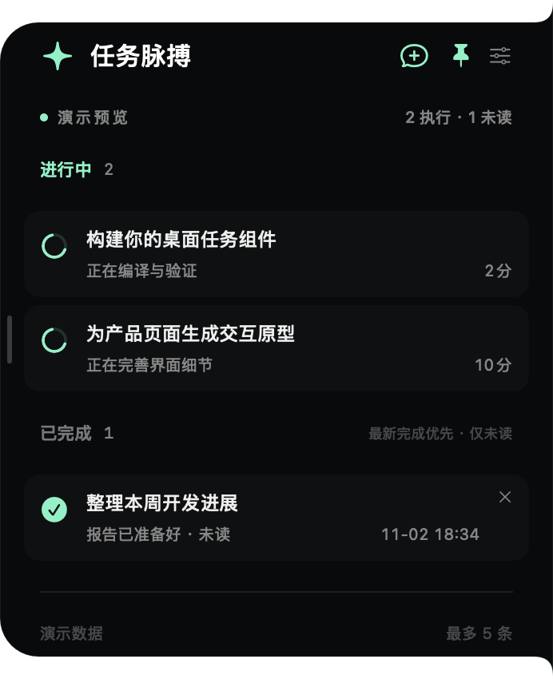

# TaskPulse — Codex Desktop Widget & Task Tracker

**Let Codex work. Keep its progress in the corner of your eye.**

A lightweight **Codex desktop widget** and **task tracker for macOS**. This native task monitor keeps running conversations and unread completions in a screen-edge sidebar, so you can follow Codex task progress without repeatedly switching windows. Inspired by [CodeNotch](https://github.com/vinzdg/codenotch).

[Download for macOS](https://github.com/zboshen/TaskPulse/releases/latest/download/TaskPulse.dmg) · [Releases](https://github.com/zboshen/TaskPulse/releases) · [中文](README.md)

- Native SwiftUI/AppKit. No Electron, embedded browser runtime, third-party Swift package dependencies, telemetry, or separate backend.
- Up to five tasks. Running tasks come first, newest first. Completed tasks appear only while unread, newest completion first.
- Choose a primary or secondary display and either screen edge. Drag the title to reposition; drag the inner edge to resize. Small, medium, and large presets adjust text and spacing together.
- One-click new Codex chat, optional launch at login, and a hide-from-Dock setting.

## Install

Requires macOS 15+. Universal arm64/x86_64 binary; Intel is cross-compiled but not yet tested on Intel hardware. Download the DMG, drag TaskPulse.app into Applications, then open it. Enable launch at login from the widget settings after installation.

The first release is ad-hoc signed and **not notarized**. macOS may block the first launch. Only if you trust the download from this repository, use the system's Privacy & Security flow to allow it. No automatic security-bypass script is provided.

## Stay in the loop

Choose **Watch → Custom → Releases**, star this repository, or [follow @zboshen](https://github.com/zboshen). An [Atom release feed](https://github.com/zboshen/TaskPulse/releases.atom) is available. There is no auto-updater in this version.

## Scope and privacy

This is an independent community project, not affiliated with OpenAI. It reads local Codex metadata and the desktop app's account/host-scoped unread list, every two seconds. It parses local login identity claims in memory to select the correct account; it does not use tokens for network requests or upload them. Databases are opened read-only.

Only the default local Codex execution host is supported. Remote tasks, standalone ChatGPT, and ordinary chats using a separate ChatGPT backend are outside the current adapter. Running tasks are restricted to turns started today in **Asia/Shanghai**. The adapter relies on private local schemas and may need updates when Codex changes them. UI language is currently Chinese.

[Data sources and privacy](docs/PRIVACY.md) · [Build instructions](docs/DEVELOPMENT.md)

## Credits

The edge shape and spring animation code are reused from [vinzdg/codenotch](https://github.com/vinzdg/codenotch) under MIT, with its original notice retained in [LICENSE-Codenotch](LICENSE-Codenotch). TaskPulse is [MIT licensed](LICENSE).
