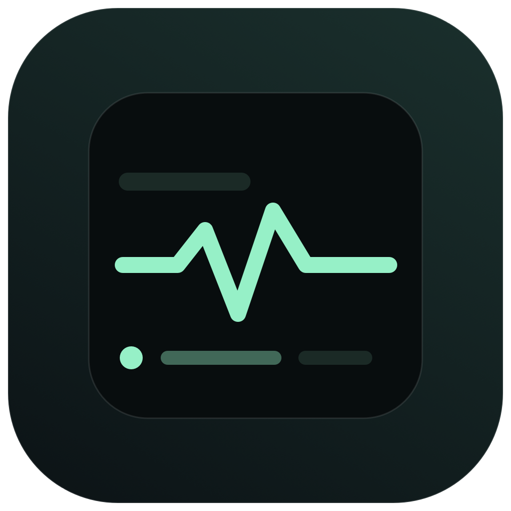
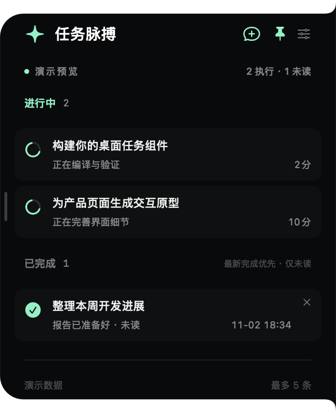

<h1 align="center">TaskPulse · 任务脉搏</h1>

<b>让 Codex 放手去做，让任务进度留在眼角。</b> A lightweight macOS edge widget for your Codex tasks.

<a href="https://github.com/zboshen/TaskPulse/releases/latest/download/TaskPulse.dmg">下载 macOS App</a> ·
<a href="https://github.com/zboshen/TaskPulse/releases">版本更新</a> ·
<a href="https://github.com/zboshen/TaskPulse/issues">反馈建议</a> ·
<a href="README.en.md">English</a>

Codex 同时跑着几个任务时，你无需反复切回窗口确认。TaskPulse 在屏幕边缘留一张小卡片：正在做什么、哪些结果等你查看，一眼就能知道。

界面与动效受 [CodeNotch](https://github.com/vinzdg/codenotch) 启发，并直接复用了其 MIT 授权的贴边轮廓与弹簧动画。TaskPulse 将这个交互收敛到一个目标：**跟进 Codex 的本机任务执行状态**。

## 轻量，具体在哪里

- **Swift + SwiftUI + AppKit 原生实现**，无 Electron、无内置浏览器运行时。
- **无第三方 Swift 包依赖**，使用系统框架与 SQLite。
- **无需独立服务端，也不用填写 API Key**，每 2 秒只读同步本机状态。
- **无广告、无遥测**。本机登录信息只用于区分未读列表所属账户，不发送或上传令牌。
- 菜单栏常驻，默认隐藏 Dock；工作时留在屏幕边缘，需要时再展开。

“轻量”指实现结构与依赖范围；我们没有把未经测试的 CPU、内存或续航数字写进介绍。

## 把注意力留给正在做的事

| 功能 | 行为 |
|---|---|
| 进行中 | 仅显示北京时间今天开始、当前轮仍在执行的 Codex 会话；新开始的优先 |
| 已完成 | 仅显示当前账户、本机的未读完成任务，按完成时间倒序；已读自动消失 |
| 最多 5 条 | 进行中先占位置，剩余位置留给未读结果；进行中 ≥ 5 时不展示已完成 |
| 一键新建 | 顶部“＋对话框”直接打开 Codex 新聊天编辑框 |
| 主副屏任选 | 选择主显示器或具体副显示器，左侧/右侧贴边 |
| 拖动位置 | 按住标题上下移动，位置自动记住；支持恢复居中 |
| 拖动大小 | 拉动内侧细竖条，字体、间距、卡片随宽度调整 |
| 大中小 | 设置中提供三种内容大小，超高内容可滚动 |
| 开机启动 | 可选，通过 macOS 原生登录项管理，默认关闭 |
| Dock 隐藏 | 可选，默认隐藏；菜单栏图标始终保留 |

## 下载与安装

首个公开版本的 DMG 约 **1.9 MB**，ZIP 约 **1.6 MB**（v0.2.0）。

**macOS 15 或更新版本。Universal：Apple Silicon + Intel。** Intel 架构已编译，尚未进行 Intel 实机验证。

1. [下载 TaskPulse.dmg](https://github.com/zboshen/TaskPulse/releases/latest/download/TaskPulse.dmg)。也可在 [Releases](https://github.com/zboshen/TaskPulse/releases) 下载 ZIP 和 SHA-256 校验文件。
2. 打开 DMG，将 **TaskPulse.app** 拖入 **Applications（应用程序）**。
3. 启动后，从卡片右上角设置选择显示器、吸附方向与内容大小。开机启动需安装到应用程序目录后手动开启。

首版采用临时签名，**尚未经过 Apple 公证**，首次运行可能被 macOS 拦截。如确认下载来源为本仓库，可在系统设置 → 隐私与安全性中按系统提供的流程允许打开。我们不提供自动绕过系统安全检查的脚本。

## 订阅我们

想跟进新功能和新版本？在仓库右上角点 **Watch → Custom → Releases** 订阅版本发布；点 **Star** 收藏项目，也欢迎 [Follow @zboshen](https://github.com/zboshen) 关注后续作品。

也可以用 RSS 阅读器订阅 [Release Feed](https://github.com/zboshen/TaskPulse/releases.atom)。首版没有自动更新器，请从 Releases 获取新版。

## 使用小提示

悬停展开，图钉固定展开；取消固定后移出鼠标自动收起。点击任务回到原会话，已读状态由 Codex 自己更新。已完成行的 × 仅在小组件中收起当前轮结果，下一轮完成仍可再次出现。

**兼容说明：** 首版适配当前 Codex 桌面版本的默认本机执行主机数据。不是 OpenAI 官方产品，也不覆盖远程任务、独立 ChatGPT/网页或应用内走独立 ChatGPT 后端的普通聊天。底层本地结构可能随 Codex 更新改变，遇到问题欢迎提交 Issue。

更多信息：[隐私与数据来源](docs/PRIVACY.md) · [源码构建与验证](docs/DEVELOPMENT.md)。

## 致谢与许可

感谢 [vinzdg/codenotch](https://github.com/vinzdg/codenotch) 对屏幕边缘交互的探索。贴边形状和动画来自 CodeNotch，原版权声明完整保留在 [LICENSE-Codenotch](LICENSE-Codenotch)。

TaskPulse 以 [MIT](LICENSE) 协议开源。欢迎使用、反馈和贡献。
